# multi_weather

## (7月22日現在:制作中です)

1日の移動予定に沿って天気をまとめて確認できるアプリケーションです。
複数地点の天気を個別に調べる手間を減らすことができます。

## URL

準備中

## 作成背景

- 外部APIとの連携方法を学び、取得したデータをアプリケーション内で活用する経験を積むため。
- Ruby on Rails学習のため。
- 複数地点の天気を時系列順に１画面で表示するアプリケーションがなかったため。

## 機能一覧

- 時系列で並べた複数地点の天気予報表示機能
  - 地点登録機能
    - 【未実装】地図GUIによる位置指定機能
    - 文字入力による位置指定機能
  - 住所変換機能
    - 【未実装】(地図GUI入力)指定した緯度経度→住所変換機能
    - 【未実装】(文字入力)入力した文字列→住所検索機能
    - 【未実装】(文字入力)住所→緯度経度を取得する機能
  - 【未実装】複数地点の天気予報取得機能
  - 【未実装】取得した天気を時系列順にマージする機能

- ユーザの機能
  - 【未実装】ユーザー登録、ログイン機能(device)
  - お気に入り地点機能
    - 【未実装】自動入力機能
      ┗通勤ルートを指定し、毎回の地点入力を省略
    - 【未実装】雨予報通知機能
      ┗ブラウザの通知orメールで雨予報を送信

- スマホ対応
  - 【未実装】縦画面レイアウトを追加
- 【未実装】非同期通信による実装

## 画面遷移図

準備中

## テスト

- RSpec
  - 【未実装】単体テスト(spec/model)
  - 【未実装】結合テスト(spec/requests)

## 使用技術

(2026-7-23現在)

- Ruby 4.0.1

- Ruby on Rails 8.1.3
  - RSpec 3.13.6
  - devise 5.0.4
- Bootstrap 5.3.8
- PostgreSQL 18.3

## 設計

### ER図

```mermaid
erDiagram
USERS {
  integer id
  string name
  string email
  string encrypted_password
}

FAVORITE_ROUTES{
  integer id
  integer user_id
  string name
}

FAVORITE_ROUTE_NOTIFICATIONS{
  integer favorite_route_id
  bool enabled
  string notification_name
  integer notification_type
  time notification_time
  integer repeat_weekdays_mask
}

SPOTS{
  integer id
  string address
  decimal latitude
  decimal longitude
}

FAVORITE_ROUTE_SPOTS{
  integer favorite_route_id
  integer spot_id
  datetime arrived_at
  datetime departed_at
}

USERS ||--o{ FAVORITE_ROUTES : has
FAVORITE_ROUTES ||--o{ FAVORITE_ROUTE_NOTIFICATIONS : contains
FAVORITE_ROUTES ||--o{ FAVORITE_ROUTE_SPOTS : contains
SPOTS ||--o{ FAVORITE_ROUTE_SPOTS : referenced_by
```

